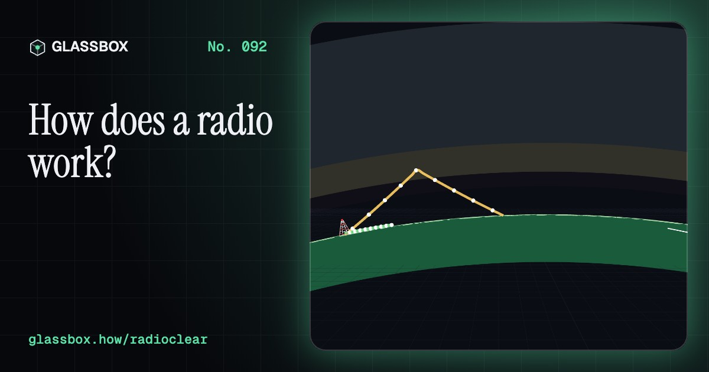
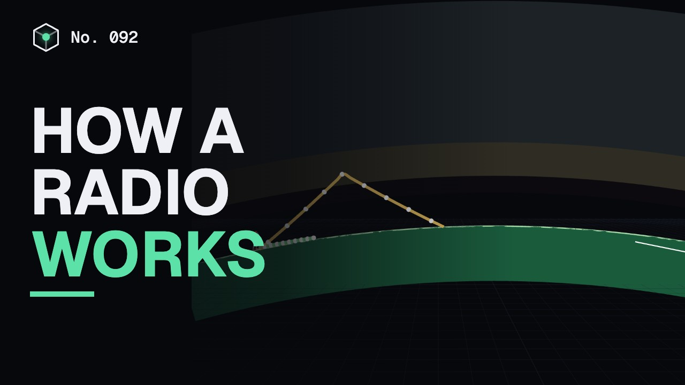
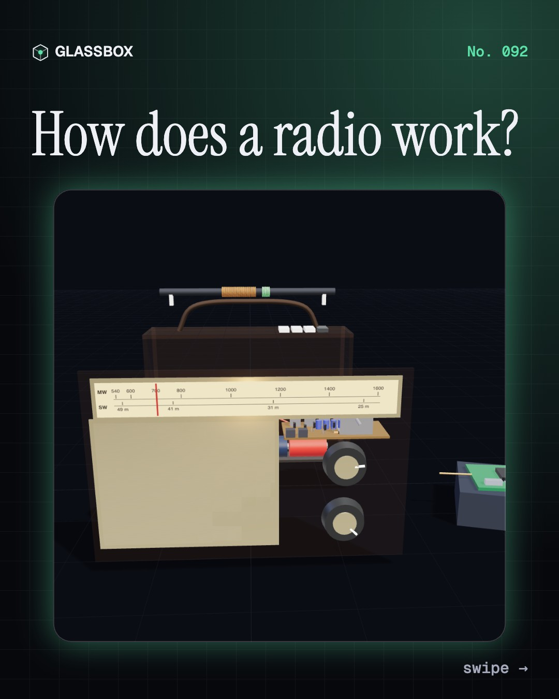
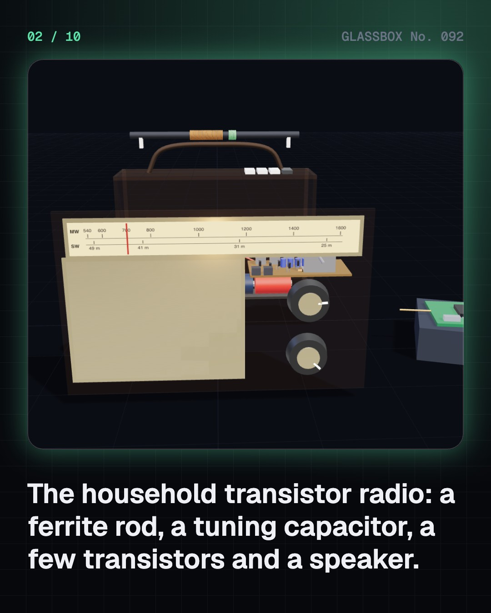
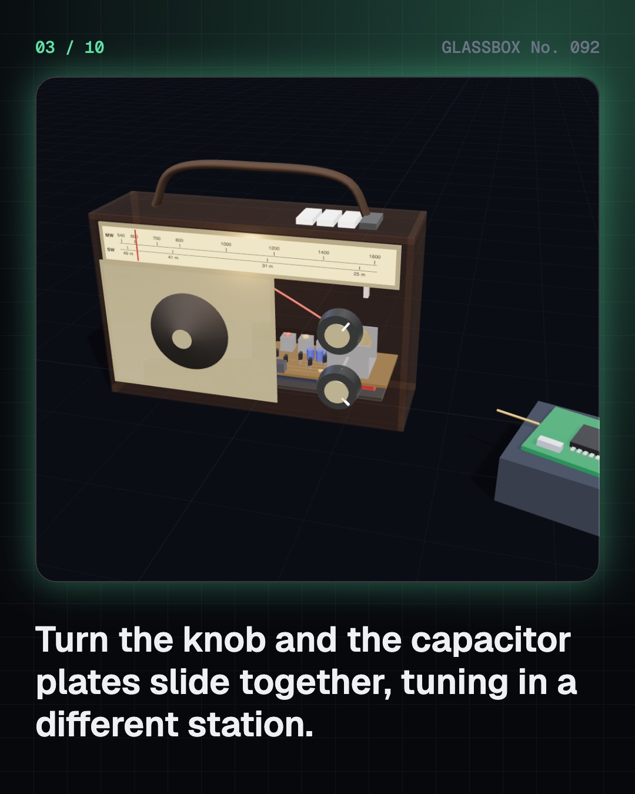
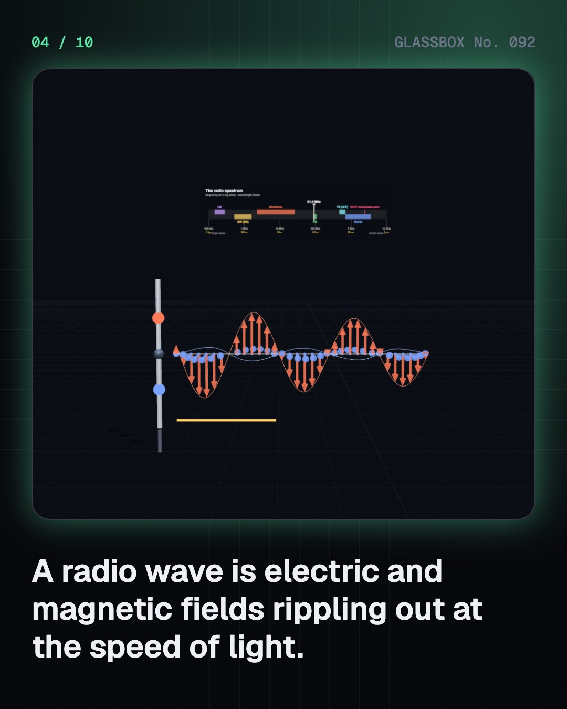

<!-- glassbox:start -->
<!-- Generated from glassbox.json by the Glassbox hub (npm run readme -- radioclear). Edit glassbox.json, not this block. -->
<p align="center"><a href="https://glassbox.how/e/radioclear/"></a></p>

<h1 align="center">RadioClear</h1>

<p align="center"><b>How does a radio work?</b><br>A radio pulls one voice out of an invisible sea of waves, using a coil, a capacitor and a diode. Open up a 1970s transistor set, shake charges into radio waves, play with AM and FM, tune a circuit into resonance and follow a signal through a superhet.</p>

<p align="center"><a href="https://glassbox.how/radioclear/"><b>▶ Play with it</b></a> &nbsp;·&nbsp; <a href="https://glassbox.how/e/radioclear/">Read the 60-second explainer</a> &nbsp;·&nbsp; <a href="https://glassbox.how/radioclear/glassbox/reel.mp4">Watch the 40-second video</a></p>

<p align="center">
  <a href="https://glassbox.how/e/radioclear/"></a>
  <a href="https://glassbox.how/e/radioclear/"></a>
  <a href="LICENSE"></a>
  <a href="LICENSE-CONTENT.md"></a>
  <a href="#privacy"></a>
</p>

## In 60 seconds

1. **A few parts, no computer.** A classic transistor radio is a ferrite rod antenna, a gang tuning capacitor, IF transformer cans, six or seven transistors, a detector diode, a speaker and four D cells (6 V). A modern radio can be one DSP chip that does the same jobs with arithmetic.
2. **Waves of electric and magnetic field.** Charges surging up and down an antenna send out linked electric and magnetic ripples at 300,000 km/s. Wavelength is c / f: AIR's medium-wave band, 531 to 1,602 kHz in 9 kHz steps, has waves 190 to 560 m long. By day the ionosphere's D layer soaks up medium waves; at night they bounce off the E layer a thousand kilometres away.
3. **A voice rides a carrier.** AM changes the carrier's size, so its envelope traces the sound and it fits in a 9 kHz channel. FM swings the frequency by up to ±75 kHz and needs about 180 kHz, but its receiver ignores the size of the wave, so most static vanishes.
4. **Tuning is resonance.** A coil and a capacitor ring at f = 1 / (2π√LC). With a 230 µH coil, 40 to 400 pF tunes the whole medium-wave band. The peak is about f / Q wide, and one tuned circuit alone lets a neighbouring station leak in.
5. **The superheterodyne.** A local oscillator runs 455 kHz above the station (10.7 MHz for FM). The mixer's difference frequency is always the same, so sharp fixed filters and most of the gain work identically on every station. A diode and capacitor then follow the envelope to recover the sound. A crystal set does it with no battery at all.
6. **Radio in India.** Akashvani reaches about 99% of Indians in 23 languages. Medium wave carries IMD cyclone bulletins far out to sea, ham operators kept the Andamans in touch after the 2004 tsunami, and hundreds of 100-watt community stations serve villages about 12 km around.

## Words worth knowing

| Term | Meaning |
|---|---|
| **Radio wave** | Linked electric and magnetic ripples moving at the speed of light, with wavelengths from millimetres to kilometres. |
| **Wavelength** | The length of one wave, λ = c / f: 366 m at 819 kHz, about 3 m for FM. |
| **Carrier** | The steady high-frequency wave a station sends, which the sound then modulates. |
| **AM and FM** | Amplitude modulation changes the carrier's size; frequency modulation changes its frequency. |
| **Sideband** | The extra frequencies either side of the carrier that the modulation creates. |
| **Resonance** | A tuned circuit's big response at its own frequency, f = 1 / (2π√LC). |
| **Q factor** | How sharp a resonance is; the peak is about f / Q wide. |
| **Intermediate frequency** | The fixed frequency a superhet shifts every station to: 455 kHz for AM, 10.7 MHz for FM. |
| **Ionosphere** | Charged layers of the upper air, 60 to 500 km up, that absorb or reflect radio waves. |

## A short history

**From a set of equations in 1865 to a voice from the sky in almost every Indian home.**

- **1865** · Maxwell predicts electromagnetic waves (James Clerk Maxwell, London)
- **1887** · Hertz makes and detects radio waves (Heinrich Hertz, Karlsruhe)
- **1895** · Bose sends millimetre waves through walls in Calcutta (Jagadish Chandra Bose, Kolkata (Calcutta))
- **1901** · A signal crosses the Atlantic (Guglielmo Marconi, Poldhu, England, to St John's, Newfoundland)
- **1906** · Fessenden's Christmas Eve broadcast (Reginald Fessenden, Brant Rock, Massachusetts)
- **1918** · The superheterodyne (Edwin Howard Armstrong, Paris)
- **1923** · The Radio Club of Bombay goes on air (Bombay Presidency Radio Club, Mumbai (Bombay))
- **1933** · Armstrong patents wideband FM (Edwin Howard Armstrong, New York)

The full story, with 30 moments, charts, people and 36 sources: [glassbox.how/e/radioclear/history](https://glassbox.how/e/radioclear/history/). The data lives in [`history.json`](history.json).

## Video and slides

Made with the Glassbox studio from this box's storyboard (`window.glassbox.director`). Free to reuse under CC BY 4.0.

<a href="https://glassbox.how/radioclear/glassbox/video.mp4"></a>

<p><a href="glassbox/slide-1.jpg"></a> <a href="glassbox/slide-2.jpg"></a> <a href="glassbox/slide-3.jpg"></a> <a href="glassbox/slide-4.jpg"></a></p>

| File | What | Size |
|---|---|---|
| [`glassbox/reel.mp4`](https://glassbox.how/radioclear/glassbox/reel.mp4) | Reel / Short, with captions and soundtrack | 1080×1920 |
| [`glassbox/video.mp4`](https://glassbox.how/radioclear/glassbox/video.mp4) | YouTube video, with captions and soundtrack | 1920×1080 |
| `glassbox/slide-1…10.jpg` | Instagram carousel | 1080×1350 |
| `glassbox/thumb.jpg` | YouTube thumbnail | 1280×720 |
| `glassbox/cover.jpg` | Share card and repo social preview | 1200×630 |
| [`glassbox/history-reel.mp4`](https://glassbox.how/radioclear/glassbox/history-reel.mp4) | “History in 10 moments” Reel / Short | 1080×1920 |
| `glassbox/history-slide-*.jpg` | History carousel | 1080×1350 |
| `glassbox/post.json` | Post copy and schedule used by the publish kit | |

## Privacy

This box has no accounts and no ads, and it ships its own fonts and libraries. When you run it yourself it sends nothing anywhere. On glassbox.how, the site's `/bar.js` also loads Glassbox's analytics: **Google Analytics** to count visits (it asks first in the EU, UK and Switzerland, and stays off when your browser sends Global Privacy Control or Do Not Track) and **ClickTrust** to detect bots.

It remembers a few things **in your own browser only**, and never sends them anywhere:

| Browser storage key | What it holds |
|---|---|
| `radioclear.v1` | Which chapters you have opened, your best quiz scores, and sound on or off. |

Exactly what each one sees is at [glassbox.how/privacy](https://glassbox.how/privacy/).

## Licences

- **Code:** [MIT](LICENSE). Use it, change it, ship it.
- **Explanations, text, images and videos** (`glassbox.json`, `glassbox/`): [CC BY 4.0](LICENSE-CONTENT.md). Credit “Glassbox, glassbox.how/e/radioclear”.
- **Third-party parts** keep their own licences: [three.js](https://threejs.org) (MIT), [Geist, Instrument Serif](https://openfontlicense.org) (SIL OFL 1.1).
- The Glassbox name and logo aren't covered by either licence. See the [terms](https://glassbox.how/terms/).

Found a mistake? [Open an issue](https://github.com/bdeeps/radioclear/issues). Corrections happen in public.
<!-- glassbox:end -->

## Run it

It's plain HTML, CSS and JavaScript. No build step and no dependencies. Run locally, it contacts no other website.

```bash
python3 -m http.server 8000
```

Three.js and the fonts ship in `vendor/` and `fonts/`, so it also works offline.

Then open http://localhost:8000.

## How it's built

| File | What |
|---|---|
| `index.html`, `css/app.css` | The page and its styles |
| `js/app.js`, `js/stage.js`, `js/ui.js`, `js/kit.js` | The shared Glassbox 3D engine: chapters, 3D stage, controls, quiz, video director |
| `js/chapters/*.js` | One file per chapter: the 3D model, controls, text, key terms, quiz and video scenes |
| `js/radio.js` | Shared radio physics (λ = c/f, LC resonance, Bessel sidebands, ionosphere hops), the AM/FM link simulation, sound player, boards and the 3D transistor radio |
| `glassbox.json` | Title, question, explainer beats, key terms, browser storage and credits shown on glassbox.how |
| `reel` in each chapter | The storyboard the Glassbox studio records into short videos |
| `glassbox/` | The published video, slides, thumbnail and post copy |
| `fonts/`, `vendor/three/` | Self-hosted Geist and Instrument Serif (SIL OFL 1.1) and three.js (MIT) |
